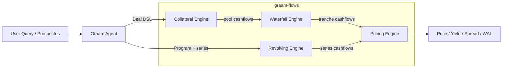

<p align="center">
  
</p>

graam-flows is the open execution layer behind [Graam](https://graam.ai).

It provides a deterministic, auditable engine for running structured credit deals — from collateral projections through waterfall execution to bond analytics.

The goal is to move structured credit away from encrypted CDI files and fragmented spreadsheet models toward a shared, executable representation of a deal.

Read more: [From CDI Files to Executable Deals](https://medium.com/@shariff.elkordy/from-cdi-files-to-executable-deals-open-sourcing-the-execution-layer-of-structured-credit-and-abf-ba17a56ee27c)

## Why this exists

Structured credit workflows today rely heavily on spreadsheets and fragmented models. Deals are often re-built independently by each party, introducing inconsistencies and operational risk.

graam-flows provides a single, executable representation of a deal that can be:
- run consistently across parties
- validated deterministically
- reused without re-building

This is a step toward making structured credit programmable.

## Relationship to Graam

graam-flows is the execution layer. [Graam](https://graam.ai) builds on top of it with:
- AI-driven deal structuring
- document parsing and generation
- end-to-end workflows for issuers and investors

This repository focuses on the deterministic modeling layer.

## How it works



## What it does

graam-flows has four engines. They can be used together or independently: project a pool, run it through a waterfall, price the tranches — or call any one of them on its own.

1. **Collateral engine** — projects loan-level or rep-line cashflows from asset data and assumptions.
   - Rate types: fixed, ARM/hybrid (reset off a supplied forward curve), step-rate; amortizing, interest-only, balloon, bullet and PIK.
   - An asset can state its own scheduled payments, a fixed monthly principal amount, its own payment calendar, and Actual/360 accrual.
   - Prepayments as `CPR`, `SMM`, `PSA` (each asset on its own age), `ABS` (% of original balance) or `CPY` (prepaying from the month call protection ends); defaults as `CDR`, `MDR` or `ORIGMDR`.
   - Severity as a percent or as a dollar loss per period; delinquency on current or original balance; advancing; recovery lag.
   - Prepayment penalty schedules, and reinvestment of proceeds into new collateral from templates during a reinvestment period.
2. **Waterfall engine** — distributes collateral cashflows across classes according to the deal's priority of payments, period by period: interest, principal, shortfalls, write-downs and write-ups, reserve and expense flows, triggers, and the balance of every class.
3. **Revolving engine** — revolving trusts with several series over one pool: credit card master trusts (revolving, accumulation and amortization phases, principal and excess sharing, de-linked notes), installment pools valued at the present value of their remaining payments, and amortizing owner trusts. Forecasts from a statement date, or replays printed monthly figures and forecasts on from there.
4. **Pricing engine** — price, yield, Z-spread, discount margin, modified duration, WAL and accrued interest from any cashflow stream against a term structure, with the common day counts (`30/360`, `30/360 SIA`, `30/360E`, `Actual/360`, `Actual/365`, `Actual/Actual`) and compounding conventions.

Runs are deterministic: the same request returns the same answer on any day and any machine. A request the engine cannot model correctly is refused with a reason, not run on a guess.

## Supported deal types

| Family | What the engine models |
|---|---|
| **Auto ABS / consumer installment** | Sequential and turbo structures, OC targets with yield supplement OC schedules, reserve accounts, OC release to the certificate |
| **Private-label RMBS (non-QM, prime)** | Shifting interest, net WAC caps and cap carryover, trigger-dependent structures, excess-spread strips, step-up coupons, losses realized on liquidation, optional redemption |
| **Credit risk transfer (CRT)** | Reference-pool deals: guaranteed interest, supplemental reduction, modification losses, computed variables, exchangeable (MACR) classes (e.g. STACR) |
| **Agency CMO** | PAC/support, accrual (Z) classes and accretion-directed classes, fixed-share principal splits, notional IO classes, exchangeable (MX) combinations, several Security Groups each paid from its own collateral |
| **CMBS** | Balloon loans on their own schedules, Actual/360 loans, interest reserve, prepayment penalties paid to IO classes, loan-specific certificates |
| **CLO** | OC/IC coverage tests with interest-to-principal diversion, reinvestment, deferrable notes, incentive fee above a hurdle IRR, quarterly payment calendars |
| **Credit card / revolving** | Master trusts and owner trusts on the revolving engine (`POST /api/revolving`) |

## Quick start

### Prerequisites

- [.NET 10 SDK](https://dotnet.microsoft.com/download)

### Build and test

```sh
dotnet build
dotnet test
```

### Run the API

```sh
dotnet run --project src/GraamFlows.Api
```

The API starts on `http://localhost:5200` with Swagger UI at `/swagger`. It binds to `$PORT` when set.

### Docker

```sh
docker build -t graam-flows .
docker run -p 5200:5200 graam-flows
```

### Run the CLI

Both commands take a deal model (or a run file, below) as a positional argument:

```sh
# project a deal and export the cashflows to Excel
dotnet run --project src/GraamFlows.Cli -- run path/to/deal.json

# validate the deal's WAL against its published decrement table
dotnet run --project src/GraamFlows.Cli -- wal-tests path/to/deal.json --verbose
```

`samples/reinvesting_deal.json` is a complete deal model to try `run` on (it carries no decrement table, so `wal-tests` has nothing to score).

`wal-tests` strikes the grid entirely from the deal model — nothing is taken from the clock, so
two runs of the same file on different days give the same answer. Three fields decide the basis:

| Field | Meaning |
|---|---|
| `firstPaymentDate` (deal level) | First distribution date, when the tranches carry only a `payDay`. Per-tranche `firstPayDate` wins; `closingDate` is the last resort. A deal that states none of the three is rejected rather than anchored to today. |
| `walScenarios.assumptions.prepaymentType` | `CPR` (% of current balance — the default, and what RMBS decrement tables are struck in), `ABS` (% of original balance, the auto-ABS convention), `PSA` or `CPY`. |
| `walScenarios.assumptions.callTriggers` | Names of the triggers the "to redemption date" column is struck to; the run stops at whichever fires first. Omitted, a dated `DATE_TERMINATION` redemption is used when the deal declares one, else the `COLLATERAL_VALUE` clean-up. |

#### Run files

Both commands also take a **run file**: the exact requests a caller sent this engine's HTTP API
for one deal, so a local run is the same run rather than a rebuild of it. The CLI binds each body
the way the API does (snake_case keys rewritten, the API's JSON options) and passes it through the
`CalcCollateral` and `Waterfall` controllers in-process, then fills the waterfall's
`collateralCashflows` from the collateral response, as the caller did.

```jsonc
{
  "graamflowsRun": 1,
  "dealName": "…", "collateralDate": "2026-10-19",
  "calcCollateral": { /* POST /api/CalcCollateral body shared by every scenario */ },
  "waterfall":      { /* POST /api/Waterfall body, without collateralCashflows */ },
  "walField": "balanceWal", "walTolerance": 0.15, "walDiffDecimals": 3,
  "scenarios": [{
    "name": "walToMaturity 25 CPY", "basis": "walToMaturity", "speed": 25, "prepaymentType": "CPY",
    "calcCollateral": { /* top-level keys that differ, e.g. assumptions */ },
    "waterfall":      { /* e.g. triggerForecasts */ },
    "collateralAdjustments": [{ "row": 9, "add": { "interest": 1250.0 } }],  // optional
    "expectedWal":  { "A1": 2.81 },   // published, scored at walTolerance
    "referenceWal": { "A1": 2.8397 }  // what the caller's own run of this request reported
  }]
}
```

```sh
# every scenario: published cells within the tolerance, and the caller's run reproduced (0.001y)
dotnet run --project src/GraamFlows.Cli -- wal-tests path/to/run.json

# one scenario's cashflows to Excel; --cpr/--cdr/--sev/--dq replace its deal-level speeds
dotnet run --project src/GraamFlows.Cli -- run path/to/run.json --scenario "walToMaturity 25 CPY"
```

`collateralAdjustments` are amounts the caller added to the engine's collateral rows between the
two calls; a scenario whose caller changed the rows in any other way carries the rows themselves
as `collateralCashflows`, and they are distributed as given. `--cpr` is refused on a scenario that
sets a speed per asset, since those vectors were derived from the scenario's own speed.

## API usage

| Endpoint | What it does |
|---|---|
| `POST /api/calccollateral` | Project pool cashflows from assets and assumptions |
| `POST /api/waterfall` | Distribute collateral cashflows across a deal's classes |
| `POST /api/pricing` | Bond analytics from a cashflow stream |
| `POST /api/revolving` | Run a revolving trust: a program, its series, and the pool they share |
| `POST /api/revolving/pool` | Run an installment pool alone: its monthly roll and present value |

The API accepts both `camelCase` and `snake_case` JSON keys. A refused request returns `400` with an `error` that says why.

### Collateral projection

`POST /api/calccollateral` projects loan pool cashflows from asset data and assumptions.

```json
{
  "projectionDate": "2024-01-25",
  "assets": [
    {
      "assetName": "Pool",
      "interestRateType": "FRM",
      "originalDate": "2023-06-01",
      "originalBalance": 100000000,
      "originalInterestRate": 6.5,
      "currentInterestRate": 6.5,
      "originalAmortizationTerm": 72,
      "currentBalance": 95000000,
      "serviceFee": 1.0
    }
  ],
  "assumptions": {
    "cpr": 6.0,
    "cdr": 1.0,
    "severity": 40.0,
    "prepaymentType": "CPR"
  }
}
```

Rates are percents (`cdr: 10` is 10%). Each assumption can be a constant, a per-period vector (`cprVector: [6.0, 7.0, 8.0, ...]`), or a ramp string (`cprVectorStr: "1.0R12,6.0"`).

| Field | Values |
|---|---|
| `prepaymentType` | `CPR` (default), `SMM`, `PSA`, `ABS`, `CPY` |
| `defaultType` | `CDR` (default), `MDR`, `ORIGMDR` |
| `severityType` | `Pct` (default), or `LossAmount`: the severity is a dollar loss per period, spread over that period's defaults |
| `delinquencyType` | `PctCurrBal` or `PctOrigBal` |
| `recoveryLag` | Months from default to recovery |

The response says which convention each run applied (`prepaymentResolution`, `delinquencyResolution`, `severityResolution`), and which index each floating asset priced on (`marketRateResolution`): a floating index the caller did not supply is refused, never assumed.

### Pricing and analytics

`POST /api/pricing` computes bond analytics from a cashflow stream.

```json
{
  "cashflows": [
    { "date": "2024-02-25", "interest": 333333, "principal": 1500000, "balance": 98500000 },
    { "date": "2024-03-25", "interest": 328333, "principal": 1500000, "balance": 97000000 }
  ],
  "params": {
    "inputType": "price",
    "inputValue": 99.5,
    "settleDate": "2024-01-25",
    "balance": 100000000,
    "dayCount": "30/360",
    "compounding": "SemiAnnual"
  },
  "rates": [[0.5, 5.0], [1.0, 4.8], [2.0, 4.6], [5.0, 4.5], [10.0, 4.4]]
}
```

Input types: `price` (solve for yield/spread), `yield` (solve for price), `spread` (solve for price from Z-spread). Returns price, yield, Z-spread, discount margin, modified duration, WAL, and accrued interest. The `rates` array provides a term structure as `[term_years, rate_percent]` pairs for spread and duration calculations. A yield the solver cannot find is refused by name rather than returned as a sentinel.

### Waterfall execution

`POST /api/waterfall` distributes collateral cashflows across tranches and returns tranche-level cashflows.

```json
{
  "projectionDate": "2024-01-25",
  "collateralCashflows": [
    {
      "cashflowDate": "2024-02-25",
      "groupNum": "1",
      "beginBalance": 100000000,
      "scheduledPrincipal": 1000000,
      "unscheduledPrincipal": 500000,
      "interest": 666667,
      "netInterest": 585417,
      "serviceFee": 81250,
      "defaultedPrincipal": 0,
      "recoveryPrincipal": 0
    }
  ],
  "deal": {
    "dealName": "EXAMPLE-2024-1",
    "waterfallType": "ComposableStructure",
    "interestTreatment": "Collateral",
    "closingDate": "2024-01-25",
    "tranches": [
      {
        "trancheName": "A",
        "originalBalance": 80000000,
        "couponType": "Fixed",
        "fixedCoupon": 5.0,
        "firstPayDate": "2024-02-25",
        "legalMaturityDate": "2030-01-25",
        "dayCount": "30/360",
        "cashflowType": "PI",
        "trancheType": "Offered",
        "payDay": 25,
        "payFrequency": 12
      },
      {
        "trancheName": "B",
        "originalBalance": 20000000,
        "couponType": "Fixed",
        "fixedCoupon": 6.0,
        "firstPayDate": "2024-02-25",
        "legalMaturityDate": "2030-01-25",
        "dayCount": "30/360",
        "cashflowType": "PI",
        "trancheType": "Offered",
        "payDay": 25,
        "payFrequency": 12
      }
    ],
    "unifiedWaterfall": {
      "executionOrder": [
        "INTEREST",
        "PRINCIPAL_SCHEDULED",
        "PRINCIPAL_UNSCHEDULED",
        "WRITEDOWN"
      ],
      "steps": [
        {
          "type": "INTEREST",
          "structure": { "type": "SEQ", "tranches": ["A", "B"] }
        },
        {
          "type": "PRINCIPAL",
          "source": "scheduled",
          "default": { "type": "SEQ", "tranches": ["A", "B"] }
        },
        {
          "type": "PRINCIPAL",
          "source": "unscheduled",
          "default": { "type": "SEQ", "tranches": ["A", "B"] }
        },
        {
          "type": "WRITEDOWN",
          "structure": { "type": "SEQ", "tranches": ["B", "A"] }
        }
      ]
    }
  }
}
```

Required fields to note:

- **`collateralCashflows[].groupNum`** must match the group emitted by the unified waterfall (`"1"` by default). The default on `PeriodCashflowDto` is `"0"`, which will cause every PayRule to be skipped.
- **`collateralCashflows[].netInterest`** drives tranche interest distribution; `interest` alone is not used. When chaining from `/api/calccollateral`, both fields are populated automatically.
- **`deal.closingDate`** seeds `FirstSettleDate` on each tranche and anchors first-period accrual. Without it, accrual days collapse to zero for `interestTreatment: "Collateral"`. A class can state its own dated date (`firstSettleDate`).
- **`tranche.payFrequency`** is **payments per year** (12 = monthly, 4 = quarterly, 2 = semi-annual, 1 = annual), not months between payments. It must match the cadence of `collateralCashflows`; `/api/calccollateral` emits monthly cashflows, so tranches should use `12`. The default is `12`.

Optional request flags:

- `reportCashLedger: true` adds a `cashLedger` section that checks the run's cash against itself, step by step. See [docs/cash-ledger.md](docs/cash-ledger.md).
- `includeCollateralCashflows: true` returns the collateral the waterfall distributed (and any reinvestment purchases).
- `triggerForecasts` forces a trigger's pass/fail state by period.

## Deal definition

Deals can be defined using the **unified waterfall** format (recommended) or the lower-level **PayRules DSL**.

### Tranches

| Field | Values |
|---|---|
| `couponType` | `Fixed`, `Floating` (index + `floaterSpread`), `TrancheWac`, `Formula` (`couponFormula`), `ExcessInterest`, `Residual` |
| `cashflowType` | `PI`, `IO`, `PO` |
| `trancheType` | `Offered`, `Exchanged`, `Reference`, `Certificate`, `ResidualInterest`, `CapFundsReserve`, `OfferedCapFundsReserve` |
| `payFrom` | How the class is paid in the engine's own terms: `Sequential`, `ProRata`, `Accrual` (a Z class), `Exchange`, `Notional`, `ExcessServicing`, `Residual`, `Expense`, `Group`, `Rule` |
| `notionalReference` / `classReference` | The classes an IO class's notional, or an exchange class's components, follow |
| `reserveConfig` | A reserve account's target: a percent of a base or of the cut-off pool, optionally capped at the note balance |

### Unified waterfall

The unified waterfall is a steps-based format where each step defines how a specific cashflow type is distributed. Step types:

| Step | Description |
|---|---|
| `EXPENSE` | Deal expense payments (trustee, servicer, senior fees) |
| `INTEREST` | Interest distribution to tranches |
| `PRINCIPAL` | Principal distribution, by `source`: `scheduled`, `unscheduled`, `recovery` (named in the order as `PRINCIPAL_SCHEDULED`, `PRINCIPAL_UNSCHEDULED`, `PRINCIPAL_RECOVERY`) |
| `ACCRUAL` | Turns the accrual (Z) classes' coupon into balance and pays it as principal to the classes it is directed to |
| `PREPAYMENT_PENALTY` | Pays the collateral's prepayment penalties to the classes named, by share, as interest |
| `SUPPLEMENTAL_REDUCTION` | Credit-support-capped subordinate reduction (CRT) |
| `MODIFICATION_LOSS` | A modification-loss priority that interleaves interest reductions with the write-down (CRT) |
| `WRITEDOWN` | Loss allocation (reverse seniority); `size: "periodLoss"` (default) or `"overPool"` |
| `WRITEUP` | Writes earlier write-downs back up to the pool |
| `RESERVE_DEPOSIT` | Reserve account deposits |
| `EXCESS_TURBO` | Pays the notes principal out of excess interest, to an OC target or to the pool (`target: 0`) |
| `EXCESS_RELEASE` / `EXCESS` | Pays out the remaining excess (one step under two names) |
| `CAP_CARRYOVER` | Net WAC cap shortfall payback |

`executionOrder` lists which steps run and in what sequence. A name no step answers to is refused, not ignored. The default order is:

```
EXPENSE -> INTEREST -> PRINCIPAL_SCHEDULED -> PRINCIPAL_UNSCHEDULED -> PRINCIPAL_RECOVERY ->
[ACCRUAL] -> WRITEDOWN -> [RESERVE_DEPOSIT] -> EXCESS_TURBO -> EXCESS_RELEASE
```

`ACCRUAL` is in it when the deal carries an accrual class, `RESERVE_DEPOSIT` when the deal declares a deposit step.

### Payable structures

Each step uses a payable structure tree to define distribution order:

| Structure | DSL | Description |
|---|---|---|
| Single | `SINGLE('A')` | One class |
| Sequential | `SEQ(A, B, C)` | Pay A fully, then B, then C |
| Pro rata | `PRORATA(A, B)` | Split proportionally by balance |
| Fixed shares | `SPLIT('30,70', A, B)` | Each leg its stated % of the amount, whatever the balances; a retired leg's share goes to the rest (JSON: `{"type": "SPLIT", "shares": [30, 70], "children": [...]}`) |
| Proforma | `PROFORMA(A, 0.6, B, 0.4)` | `SPLIT` with its shares written as fractions |
| Shifting interest | `SHIFTI(0.7, seniors, subs)` | Split by percentage (70/30), constant or from a variable |
| Enhancement cap | `CSCAP(0.055, seniors, subs)` | Redirect excess credit support to subs |
| Target balance | `TARGET('var', primary, cap)` | Pay the primary leg down to a target balance, the rest to the cap leg |
| Planned amortization | `PAC('schedule', senior, support)` | Pay the PAC class to its scheduled balance, the rest to support |
| Fixed amount | `FIXED(var, primary, overflow)` | Fixed dollar amount to primary, rest to overflow |
| Forced paydown | `FORCE_PAYDOWN(forced, support)` | Force one tranche to zero first |
| Accrete | `ACCRETE('OC')` | Accrete an OC class's balance from excess |

Structures can be nested: `SEQ(PRORATA('A-1','A-2','A-3'), SINGLE('B'), SINGLE('C'))`.

### Trigger-dependent structures

Principal structures can switch based on trigger pass/fail state:

```json
{
  "type": "PRINCIPAL",
  "source": "scheduled",
  "rules": [
    {
      "when": { "pass": ["CE_Test"] },
      "structure": { "type": "SHIFTI", "shiftVariable": "ShiftPct", ... }
    },
    {
      "structure": { "type": "SEQ", "tranches": ["A", "B", "C"] }
    }
  ]
}
```

Rules are evaluated in order; the first match wins. A rule with no `when` is the unconditional fallback. Triggers are formulas over the deal's state (delinquency, cumulative loss including modification write-downs, credit support, OC and dates); a termination trigger ends the deal, and can pay interest for the month of redemption.

### Deal-level features

These sit on `unifiedWaterfall`, on `deal`, or on the step named:

| Field | What it does |
|---|---|
| `waterfallOrder` | `standard` (all interest, then all principal), `interestFirst` or `principalFirst` (per seniority level) |
| `coverageCascade` | CLO OC/IC tests, each level curing by diverting interest to principal |
| `interestDiversion` | Reinvestment-period interest diversion test, run to a fixed point |
| `incentiveFee` | A fee on the residual above a hurdle IRR |
| `deferrableNotes` | Unpaid interest added to a deferrable class's balance while a senior class is outstanding |
| `expensesAfterInterest` / `expensesFromPrincipal` | Expenses carried past interest, topped up or paid from principal proceeds |
| `interestFromPrincipal` / `principalAfterNotes` | Notes' unpaid interest paid from principal ahead of their principal; principal left after the notes |
| `writeNotesDownToPool` | Write the notes down to the pool's balance |
| `lossesRealizedOnLiquidation` | Realize a loss when the loan is liquidated (after the recovery lag), not when it defaults |
| `computedVariables` | Named formulas the steps and triggers read |
| `deal.reinvestment` | Buy new collateral from templates during the reinvestment period, on the run's own assumptions |
| `deal.exchangeShares` | Exchangeable (MACR / MX) combinations of classes |
| `ocTarget` (on `EXCESS_TURBO`) | Target OC = max(percent × pool, floor), optionally with a yield supplement OC schedule (`ysoc`) |

### Collateral groups

A deal whose classes are each paid only from their own group's collateral (an agency REMIC's Security Groups) states each group past the first in `unifiedWaterfall.groups`, with its own steps; `steps` are group `"1"`'s:

```json
"unifiedWaterfall": {
  "executionOrder": ["INTEREST", "PRINCIPAL_SCHEDULED", "PRINCIPAL_UNSCHEDULED", "PRINCIPAL_RECOVERY", "WRITEDOWN"],
  "steps": [ ...group 1's steps over A and B... ],
  "groups": [{ "groupNum": "2", "steps": [ ...group 2's steps over C and D... ] }]
}
```

A class is in the group whose steps name it, and is paid only from the collateral rows carrying that `groupNum`; a net-WAC class bears its own group's rate. Each group states `INTEREST`, `PRINCIPAL` (scheduled) and `WRITEDOWN`, and may state `ACCRUAL` and `PREPAYMENT_PENALTY`; the `executionOrder` is one for every group. An exchange (MX) class is in its components' group.

Two fields on a group cover a group that is not paid solely from its own collateral (a CMBS asset group, whose loan's principal pays its own class first and then the pooled cascade):

- `"sharesClasses": true` — its steps may name classes another group's steps name. A class two groups name is shared: every group holds it, each paying it from its own collateral, and it takes its place in group 1's loss order. Every group past the first that names a shared class states it.
- `"interest": "pooled"` — its collateral's interest (and net interest) is posted in group 1's row each period, so group 1's `INTEREST` step pays it; its own `INTEREST` step may then pay only classes group 1's also pays. `"own"`, the default, pays it through its own `INTEREST` step.

A loan-specific group (a note held outside the pool, paying only its own classes, an interest-only class with the classes it is notional to, a vertical interest pro rata beside them) needs neither: it is a group's steps over its own classes.

Refused: a class two groups' steps name unless the groups past the first state `sharesClasses`, an exchange class whose components are in two groups or are shared, a pooled group whose `INTEREST` step pays a class group 1's does not, an `interest` other than `own` or `pooled`, a group numbered other than 2, 3, ..., a group stated twice, any other step type in a group, explicit `dealStructures` beside the groups, an engine other than ComposableStructure, and collateral whose groups are not exactly the waterfall's (a group with steps and no collateral, or collateral no group's steps pay).

### Prepayment penalties

An asset may state a prepayment penalty schedule, `prepaymentPenalties`: steps of `{ "from", "pct" }` in date order. From the payment date in `from`'s month, a voluntary prepayment pays `pct` percent of the principal prepaid, until the next step; the last step is a 0 where the penalty ends. Defaults, balloons and the end of the projection pay none. The schedule does not hold prepayments (call protection is `lockoutEndDate` and its siblings). The response lists the assets whose schedule ran in `prepaymentPenaltyAssetIds`, and each period's `prepaymentPenalty` is its own field, not part of `interest`.

A deal pays the penalties with a `PREPAYMENT_PENALTY` step after `INTEREST`, naming the classes and their shares (totalling 100):

```json
{ "type": "PREPAYMENT_PENALTY", "shares": [{ "tranche": "IO", "pct": 100 }] }
```

Each class is paid its share whole, as interest: it is in the class's `interest` and also reported as its `prepaymentPenalty`. A penalty no step pays, a step with no shares, shares that do not total 100, a class the deal does not carry, and a step ahead of `INTEREST` are refused.

### Excess spread covering losses

How excess spread meets losses is stated in two step fields, neither on unless stated: `EXCESS_TURBO` with `target: 0` pays the notes down to the pool out of excess interest, and `WRITEDOWN` with `size: "overPool"` writes down only what the notes still stand above the pool. A deal that states either is checked for its execution order, its shape, and what the two steps find as they run, because a mis-stated deal would otherwise return a plausible grid with a loss counted wrongly. See [docs/excess-spread-losses.md](docs/excess-spread-losses.md).

## Revolving trusts

`POST /api/revolving` runs N series over one pool. A request names the `program`, the `statementDate` (the month end of the last closed period), the `poolBalance`, the forecast `drivers` (payment rate, new receivables, yield, charge-offs, recoveries, dilution), and its `series`, each with its classes, fees, phase dates (`accumulationStart`, `expectedDate`, a `controlledAmount`), principal and excess sharing, and required reserve. `actualPeriods` replays printed monthly pool figures first and forecasts on from the last one.

`program.ownerTrust` runs an amortizing owner trust over an installment pool, and `program.masterTrust` a master trust of series valued at their own discount rates over one installment pool. `POST /api/revolving/pool` runs an installment pool on its own.

## Project structure

```
src/
  GraamFlows.Api/          REST API (ASP.NET Core): controllers, request models, transformers
  GraamFlows.Cli/          Command-line interface (run, wal-tests, run files)
  GraamFlows.Core/         Collateral, waterfall, revolving and rules engines; triggers
  GraamFlows.Domain/       Domain models (Deal, Tranche, PayRule, etc.)
  GraamFlows.Objects/      Interfaces, enums, data contracts
  GraamFlows.Util/         Pricing analytics, calendars, day counters, term structure, solvers
tests/
  GraamFlows.Tests/        Unit and integration tests (xUnit)
samples/                   Example deal models
docs/                      Reference for the cash ledger and the excess-spread loss checks
```

### Core components

- **Amortizer** (`Core/AssetCashflowEngine/Amortizer.cs`) — High-performance collateral cashflow generator. Uses a struct-of-arrays asset layout (`AssetDataArrays`) and tight, allocation-free inner loops for cache locality — execution itself is single-threaded. Projects scheduled principal, prepayments, defaults, recoveries, delinquencies and prepayment penalties.
- **ComposableStructure** (`Core/Waterfall/Structures/ComposableStructure.cs`) — The waterfall execution engine. Runs step-based waterfall periods, tracking available funds through each step; each principal payment returns a receipt of what it paid, and the step spends that.
- **Payable structures** (`Core/Waterfall/Structures/PayableStructures/`) — Composable payment distribution trees (Sequential, Prorata, Split, ShiftingInterest, EnhancementCap, Target, PAC, etc.).
- **RulesEngine** (`Core/RulesEngine/`) — Compiles PayRule DSL formulas into executable C# at runtime using Roslyn. Supports trigger conditions, variable lookups, balance queries, and structure-building functions. Identical rules compile once.
- **Revolving engine** (`Core/Revolving/`) — Pool ledger, allocator, series phases, funding accounts and triggers for revolving trusts; installment pools, owner trusts and master trusts.
- **UnifiedWaterfallBuilder** (`Api/Transformers/UnifiedWaterfallBuilder.cs`) — Transforms the steps-based JSON format into PayRule DSL for the engine. The other mappers in `Api/Transformers/` turn the deal-level features (coverage cascade, interest diversion, incentive fee, reinvestment, YSOC, revolving programs) into engine objects.
- **Cashflow** (`Util/Finance/Cashflow.cs`) — Bond analytics calculator. Computes price, yield, Z-spread, discount margin, modified duration, WAL, and accrued interest from any cashflow stream against a term structure.
- **Solvers** (`Util/Solvers1D/`) — Numerical root-finding (Brent, Newton-Raphson, bisection, etc.) used by the pricing engine to solve for yield and spread.

## License

Business Source License 1.1 — converts to Apache 2.0 on April 3, 2029. See [LICENSE](LICENSE).
